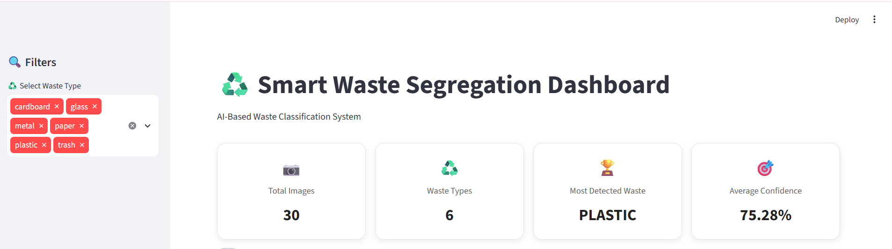
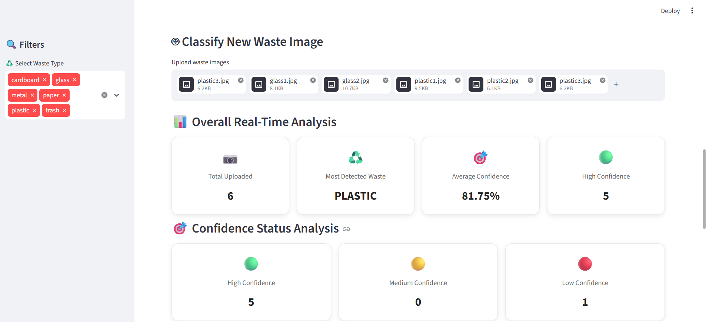
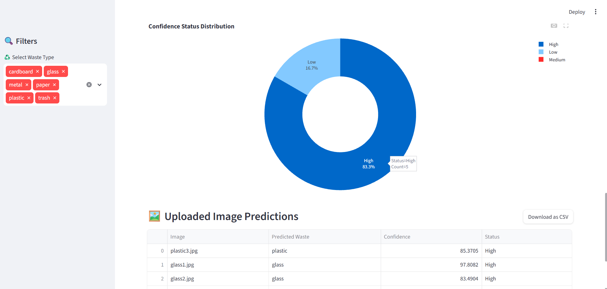

# ♻️ Smart Waste Segregation AI Dashboard

## 📌 Project Overview

Smart Waste Segregation AI Dashboard is a machine learning-based application that automatically classifies different types of waste using image recognition.

The project uses a Convolutional Neural Network (CNN) model developed with TensorFlow and Keras to identify waste categories from uploaded images. An interactive dashboard built using Streamlit allows users to upload waste images, view classification results, monitor prediction confidence, and analyze waste segregation records.

The main objective is to support smarter waste management through automated image classification and interactive data visualization.

## 🎯 Objectives

- Automate waste classification using Machine Learning.
- Identify different waste categories from uploaded images.
- Display prediction results with confidence scores.
- Monitor waste classification activities through an interactive dashboard.
- Support effective waste management and segregation.

## 🛠️ Technologies Used

| Category                | Technologies      |
| ----------------------- | ----------------- |
| Programming Language    | Python            |
| Machine Learning        | TensorFlow, Keras |
| it has                  | Pillow, NumPy     |
| Data Analysis           | Pandas            |
| Dashboard Development   | Streamlit         |
| Data Visualization      | Plotly            |
| Development Environment | VS Code           |

## ♻️ Waste Categories

The trained model classifies waste images into six categories:

- 📦 Cardboard
- 🍾 Glass
- 🔩 Metal
- 📄 Paper
- 🧴 Plastic
- 🗑️ Trash

## 📊 Dataset Information

The project uses an image dataset containing six different waste categories.

| Waste Category | Number of Images |
| -------------- | ---------------: |
| Cardboard      |              403 |
| Glass          |              501 |
| Metal          |              410 |
| Paper          |              594 |
| Plastic        |              482 |
| Trash          |              137 |
| **Total**      |        **2,527** |

**Dataset Details:**

- Total Images: 2,527
- Image Format: RGB
- Image Resolution: 512 × 384 pixels
- Number of Categories: 6

## 🧠 Machine Learning Model

A Convolutional Neural Network (CNN) model is used to classify waste images.

**Model Details:**

- Model Architecture: CNN
- Framework: TensorFlow and Keras
- Model Format: `.keras`
- Validation Accuracy: 73.53%

The trained model is saved as `waste_classifier.keras` and integrated into the Streamlit dashboard for image classification.

## 📈 Dashboard Features

The interactive Streamlit dashboard provides the following features:

- **Image Upload:** Upload waste images for automatic classification.
- **Waste Classification:** Predict the category of the uploaded waste image.
- **Confidence Score:** Display the model's prediction confidence.
- **Prediction Status:** Categorize prediction confidence into three levels:
  - High: 80% and above
  - Medium: 60%–79%
  - Low: Below 60%
- **Prediction History:** Store and view previous prediction records.
- **Category Filtering:** Filter dashboard records based on waste categories.
- **Interactive Visualization:** Explore waste segregation information through dashboard visualizations.

## 📸 Dashboard Screenshots

### Main Dashboard

### Waste Image Prediction

### Confidence Status distribution 

## ⚙️ Project Workflow

1. Upload a waste image through the Streamlit dashboard.
2. Preprocess the uploaded image by resizing and preparing it for prediction.
3. Pass the processed image to the trained CNN model.
4. Predict the corresponding waste category.
5. Calculate and display the prediction confidence score.
6. Save the prediction details in the CSV file.
7. Display prediction records and visualizations on the dashboard.

## 🔮 Future Enhancements

- Improve classification accuracy with additional training data.
- Add more waste categories.
- Integrate real-time waste classification.
- Explore IoT-based automated waste segregation.
- Deploy the dashboard on a cloud platform.

## 👩‍💻 Author

**Swathi Suresh**

B.Tech Information Technology

GitHub: [swathisuresh-19](https://github.com/swathisuresh-19)

---

⭐ If you find this project interesting, don't forget to give the repository a star!
